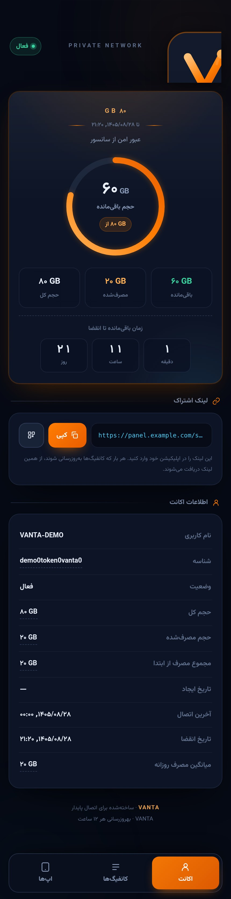
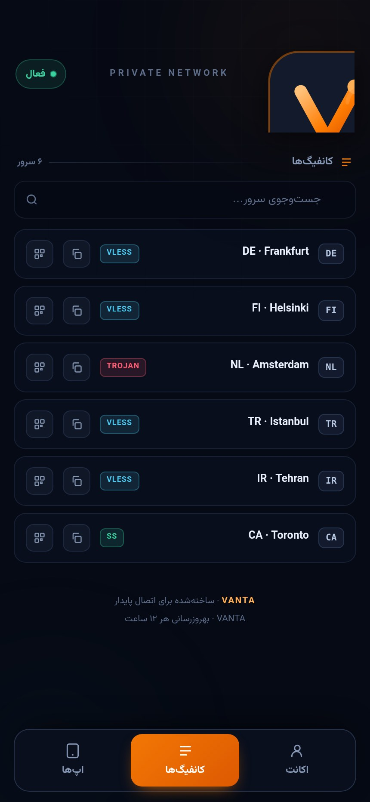
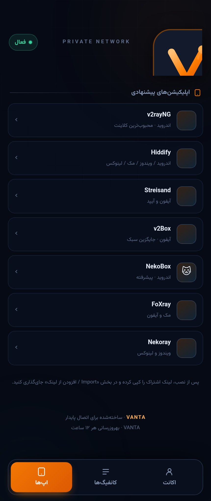
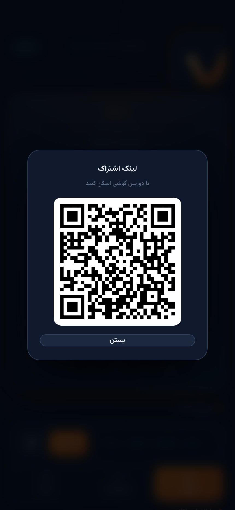

<p align="center">
  
</p>

<p align="center">
  <b>A subscription page that doesn't look like every other subscription page.</b><br>
  <sub>Dark. Fast. Ships as a 3x-ui theme, a static page, or both.</sub>
</p>

<p align="center">
  
  &nbsp;
  
  &nbsp;
  
  &nbsp;
  
</p>

---

## What this is

Most subscription pages are the same three templates recolored: a panel dumps a
base64 blob, a page parses it, and everyone gets the same rounded card with the
same ring in the same corner.

VANTA is a subscription page built around one idea: **the number you actually
care about should be the biggest thing on screen.** It ships two ways, sharing
the same markup and styles:

- **as a 3x-ui theme** — the panel renders it, so there is no second service, no
  extra port, and no token sitting in a URL the client has to keep
- **as a static page** — for any other panel (Marzban, Marzneshin, Hiddify, or
  one you wrote yourself). One HTML file, one JSON file, one Python script that
  fills it in.

No framework. No bundler. No node_modules.

## Install as a 3x-ui theme

```bash
bash <(curl -fsSL https://raw.githubusercontent.com/frank0live/vanta-sub/main/install.sh)
```

The installer:
1. checks it is running as root and locates the 3x-ui panel
2. downloads `sub.html` and checks its sha256
3. copies it to `/etc/3x-ui/sub_templates/vanta/`
4. backs up `x-ui.db` (WAL-safe) before touching anything
5. sets the `subThemeDir` settings key
6. fetches a real subscription link back from the panel to confirm it renders

> **No panel restart.** The panel reads `subThemeDir` from the database on every
> request and re-parses the template when its mtime changes, so the file goes
> live the moment it lands. If the template has an error the panel logs it and
> falls back to its own page, so subscribers never see a broken screen.

### Manual install

1. Put `sub.html` somewhere readable, e.g. `/etc/3x-ui/sub_templates/vanta/`.
2. In the panel settings, point **subThemeDir** at that folder.

### What the theme reads

The panel hands the page its data on every request, so nothing is fetched
client-side and no token is exposed:

| from the panel | used for |
|---|---|
| `subUrl` / `subJsonUrl` / `subClashUrl` | the copy-and-QR row |
| `downloadByte` / `uploadByte` / `totalByte` | the gauge and the three stats |
| `expire` / `lastOnline` | countdown, "last connection" |
| `enabled` / `isOnline` | the status pill |
| `links` / `emails` | config list, account rows |
| `announce` / `subUpdates` / `subTitle` | optional banner, footer interval, title |

## Install as a static page

```bash
git clone https://github.com/frank0live/vanta-sub
cd vanta-sub
python3 build.py --demo          # writes data.json with sample data
python3 -m http.server 8080      # open http://localhost:8080
```

Then point it at a real subscription:

```bash
python3 build.py "https://your-panel.com/sub/TOKEN" \
  --plan "PREMIUM" \
  --plan-code "80GB / 30D" \
  --tagline "عبور امن از سانسور"
```

`build.py` fetches the URL, decodes the payload (base64 or plain), parses
`vless://`, `vmess://`, `trojan://`, `ss://`, `hysteria2://` links, reads the
`subscription-userinfo` header, and writes `data.json`. The same parser runs in
the browser for the theme build, so both paths read links identically.

### Options

| flag | meaning |
|---|---|
| `--out PATH` | where to write (default `data.json`) |
| `--name` | brand name in the header |
| `--subtitle` | small caps line under the name |
| `--plan` | plan label on the hero card |
| `--plan-code` | short code under it, e.g. `80GB / 30D` |
| `--tagline` | one-line description |
| `--logo` | optional **square** brand icon; omit for the built-in SVG monogram |
| `--timeout` | HTTP timeout in seconds |

## Features

**Account view**
- Radial gauge showing **remaining** volume (not used — you open this page to
  know how much you have left, not how much you burned)
- Remaining / used / total in one row, colour-coded by meaning
- Live countdown to expiry in days · hours · minutes, turning red inside 3 days
- Subscription link with one-tap copy and a QR modal, QR generated locally with
  no external service
- Full account table: username, ID, status, created, last connection, expiry,
  daily average — every value tappable to copy

**Configs view**
- Country chip per server, derived from the panel's own naming (`DE`, `FI`,
  `IR`, ...) — text chips, not emoji flags, so they render identically on every
  device instead of showing tofu boxes
- Protocol badge (VLESS / VMess / Trojan / Shadowsocks / Hysteria2)
- Instant search across name, host and protocol
- Per-config copy and QR

**Apps view**
- Curated client list per platform, edited in `apps.json`

**Under the hood**
- The theme build is self-contained: font subset, logo and QR encoder are all
  inlined, so it works on a panel with no outbound access and needs no CDN
- Persian-first: RTL layout, Persian digits, Jalali dates via `Intl`
- Respects `prefers-reduced-motion`, uses `dvh` for mobile viewport, safe-area
  insets for notched phones
- The panel's `announce` text is painted as text, never as markup

## Build the theme yourself

`tools/build_theme.py` turns the static site into `sub.html`:

```bash
python3 tools/build_theme.py            # writes sub.html
go run tools/render_check.go sub.html   # render, then node --check the output JS
```

The render check matters: the panel runs the file through Go's `html/template`,
which strips comments and rewrites characters inside `<script>`. A page that
looks fine on disk can still ship broken JavaScript. The check renders it the
way the panel does and syntax-checks what comes out.

## Customising

Everything visual lives in `index.html` — one `<style>` block and one `<script>`
block, both commented by section.

```css
:root{
  --brand:#ff7d03;      /* accent */
  --bg:#060a14;         /* page background */
  --card:rgba(17,25,44,.72);
}
```

To change the wordmark, edit `.brand-name` and the `<title>`. To use your own
logo, pass `--logo assets/your-icon.png` — it expects a **square** image, since
the header slot is a 44×44 tile.

To add or remove clients, edit `apps.json`:

```json
{ "name": "v2rayNG", "desc": "اندروید · محبوبترین کلاینت", "icon": "🤖",
  "url": "https://github.com/2dust/v2rayNG/releases/latest" }
```

## `data.json` shape

```jsonc
{
  "brand": { "name": "VANTA", "plan": "PREMIUM", "planCode": "80GB / 30D",
             "tagline": "...", "subtitle": "PRIVATE NETWORK", "logo": null },
  "user":  { "username": "...", "id": "...", "status": "active",
             "used": 19327352832, "total": 85899345920, "lifetime": 19327352832,
             "expire": 1795123200, "created": 1792531200, "online": 1795046400,
             "sub_url": "https://panel/sub/TOKEN", "daily_avg": 644245094 },
  "configs": [ { "protocol": "vless", "name": "DE · Frankfurt",
                 "host": "de1.example.net", "port": 443,
                 "net": "ws", "tls": "tls", "sni": "de1.example.net",
                 "link": "vless://..." } ],
  "apps":  [ { "name": "...", "desc": "...", "icon": "🤖", "url": "..." } ],
  "build": "built 2026-10-21 22:00 UTC"
}
```

Bytes are plain integers. `expire` / `created` / `online` are Unix seconds.
Any field you leave out is skipped in the UI rather than rendering as `undefined`.

## Deploy the static version

Any static host works — there is no server-side code. GitHub Pages: push, then
Settings → Pages → deploy from `main` / root.

To keep the numbers fresh:

```cron
*/30 * * * * cd /srv/vanta-sub && python3 build.py "https://panel/sub/TOKEN" && git commit -am "usage" && git push
```

The page refetches `data.json` with `cache: 'no-store'` on every load, so a push
is enough — no cache busting needed. **Never commit a real token.** If you host
this publicly, generate `data.json` server-side and keep the subscription URL
out of git. The token in `demo.json` is fake.

## Files

- **`sub.html`** — the 3x-ui theme build, installed by `install.sh`.
- **`install.sh`** — installer for the theme build.
- **`index.html`** — the static page (fetches `data.json`).
- **`build.py`** — fetches a subscription URL and writes `data.json`.
- **`tools/`** — theme build script and render check.
- **`docs/`**, **`assets/`** — screenshots and brand assets.

## Browser support

Anything from 2021 onward. Uses `dvh`, `:has`-free CSS, optional chaining, and
`Intl.DateTimeFormat` with `calendar: 'persian'`. Falls back gracefully if the
Persian calendar is unavailable.

## License

MIT — see [LICENSE](LICENSE).

The static page loads Vazirmatn from jsDelivr under the SIL Open Font License;
the theme build embeds a subset of the same font.
`assets/qrcode.js` is [qrcode-generator](https://github.com/kazuhikoarase/qrcode-generator)
by Kazuhiko Arase, MIT.

## Support

- 💬 Telegram: [@master_supports](https://t.me/master_supports)
